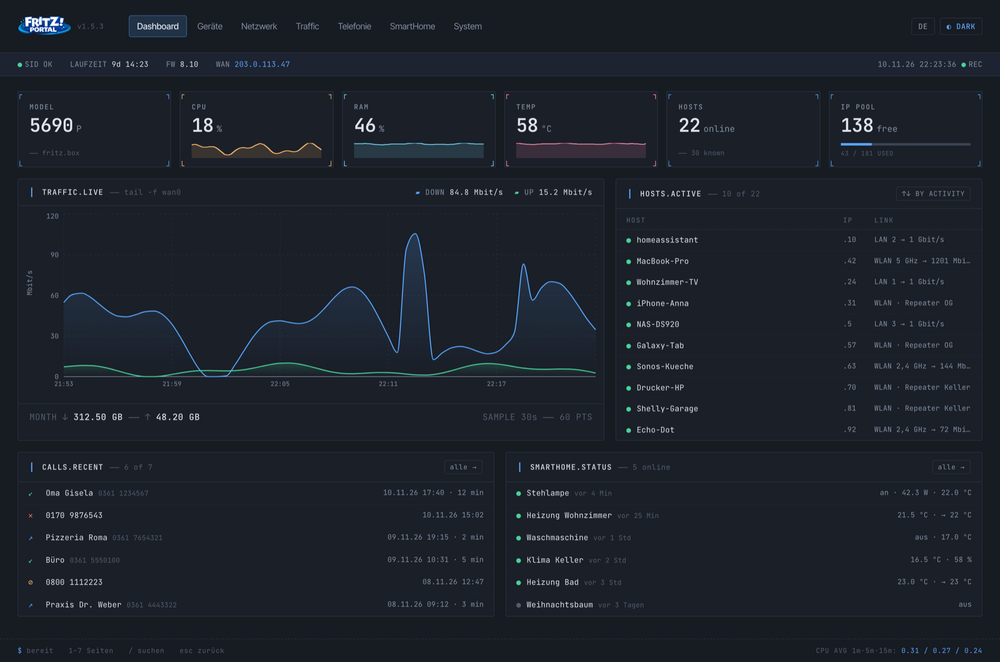
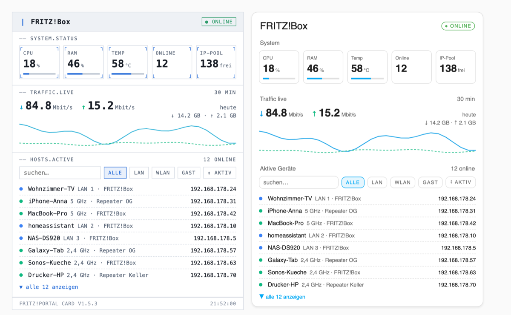

# FRITZ!Portal – Dokumentation

Das FRITZ!Box-Dashboard für Home Assistant: Status, Geräte, Mesh, Traffic, Telefonie und Smart Home in einer Oberfläche, dazu Sensoren, Schalter und Events für eigene Automationen.



## Funktionen

- **Dashboard**: CPU, RAM, Temperatur, Geräte und IP-Pool mit Verlauf, Live-Traffic, aktive Geräte, letzte Anrufe und Smart-Home-Status (die beiden letzten Boxen sind unter **System** abschaltbar)
- **Geräte**: alle Geräte mit Suche, Filter und Sortierung. In den Details: umbenennen, IPv4 dauerhaft zuweisen, Zugangsprofil wählen, Internet sperren, Gerät an Home Assistant übergeben, Offline-Geräte löschen
- **Netzwerk**: LAN, WAN, WLAN und DHCP; WLAN je Funknetz ein/aus (z. B. Gastzugang) und WLAN-Passwort ändern; Mesh-Topologie als Baum (Mesh) oder Grafik (Netzwerk)
- **Traffic**: Online-Zähler für Heute, Gestern, Woche, Monat und Vormonat; Online-Monitor mit Auslastung nach Heimnetz, IPTV, Gastnetz und Priorisierungsklassen
- **Telefonie**: Anrufliste und DECT-Telefone
- **SmartHome**: alle Smart-Home-Geräte inkl. Zigbee (ab FRITZ!OS 8.20) mit Schaltzustand, Temperatur, Leistung, Energie und Akku
- **System**: FRITZ!Box-Infos und Neustart; Einstellungen für die HA-Sensoren
- **Design & Sprache**: Terminal-Look oder Home-Assistant-Design (Knopf **„▣ PORTAL" / „⌂ HA"** oben rechts), jeweils hell und dunkel; im HA-Design mit Farben und Hell/Dunkel des aktiven HA-Themes. Sprache Deutsch, Englisch oder Italienisch über die Sprach-Pille im Header

## Voraussetzungen

**FRITZ!Box-Benutzer:** Lege in der FRITZ!Box unter **System → FRITZ!Box-Benutzer** einen eigenen Benutzer für FRITZ!Portal an und gib ihm diese Rechte:

| Berechtigung | Wird benötigt für |
|---|---|
| **FRITZ!Box-Einstellungen** | Modell/Firmware, CPU/RAM/Temperatur, Neustart, WLAN (inkl. Gastzugang), feste IP-Adressen, Geräte löschen, Internet-Sperre |
| **Sprachnachrichten, Faxnachrichten, FRITZ!App Fon und Anrufliste** | Anrufliste und Telefonie-Sensoren |
| **Smart Home** | Smart-Home-Geräte |

Außerdem unter **Heimnetz → Netzwerk → Netzwerkeinstellungen** die Option **„Zugriff für Anwendungen zulassen"** einschalten. Ohne sie lehnt die FRITZ!Box Anfragen über TR-064 ab (`401 Invalid Action`).

**MQTT (empfohlen):** Mit dem **Mosquitto-Add-on** und der MQTT-Integration erscheinen alle Sensoren gesammelt als Gerät „FRITZ!Portal" in Home Assistant. Schalter (WLAN, Internetzugang, WoL) funktionieren nur über MQTT. Ohne MQTT-Broker kannst du `ha_sensors` einschalten; die Sensoren kommen dann einzeln per REST-API, aber ohne Schalter.

## Konfiguration

| Option | Beschreibung | Standard |
|---|---|---|
| `fritzbox_host` | Hostname oder IP der FRITZ!Box | `fritz.box` |
| `fritzbox_user` | Benutzername des FRITZ!Box-Benutzers | – |
| `fritzbox_password` | Passwort des FRITZ!Box-Benutzers | – |
| `ha_sensors` | REST-API-Fallback für die Sensoren – nur ohne MQTT-Broker nötig. Nicht gleichzeitig mit MQTT nutzen, sonst gibt es doppelte Entitäten. | `false` |
| `ha_sensors_interval` | Intervall der Systemsensoren in Sekunden | `60` |
| `ha_sensors_traffic_interval` | Intervall der Traffic-Sensoren in Sekunden | `300` |
| `ha_phone_sensors` | Telefonie-Sensoren: letzter Anruf sowie letzter eingehender, verpasster und ausgehender Anruf, je auch mit Name, Nummer und Zeit als eigene Sensoren | `false` |
| `keep_session_alive` | Sitzung zur FRITZ!Box dauerhaft offen halten. **Nötig, damit Sensoren und Schalter auch ohne geöffnetes Panel arbeiten.** Erzeugt etwas mehr Last auf der FRITZ!Box. | `false` |
| `traffic_history_server` | Traffic-Verlauf der letzten 30 min im Add-on sammeln, damit das Diagramm beim Öffnen sofort lückenlos ist | `false` |
| `debug_logging` | Alle Anfragen an die FRITZ!Box ins Protokoll schreiben – nur zur Fehlersuche | `false` |
| `dashboard_card` | Dashboard-Card beim Start installieren und als Lovelace-Ressource eintragen | `true` |

Die Anmeldung an der FRITZ!Box erfolgt beim Start automatisch mit diesen Daten. Ein separates Login gibt es nicht.

## Home Assistant

**Sensoren** (per MQTT, Gerät „FRITZ!Portal"): CPU, RAM, Temperatur, Geräte online, freie IPs, Download/Upload, Traffic-Zähler, Internetverbindung, Anschlussart, externe IP, DSL-Sync, Mesh-Geräte, Netzwerk-Topologie, Smart Home und FRITZ!OS-Update. Mit `ha_phone_sensors` zusätzlich die Telefonie-Sensoren.

**Schalter:**
- **WLAN**: Jedes Funknetz (inkl. Gastzugang) als `switch.fritzportal_wlan_…`
- **Einzelne Geräte**: In den Gerätedetails „In Home Assistant bereitstellen" einschalten. Das Gerät erscheint dann als eigenes HA-Gerät mit Schalter **Internetzugang**, Button **Aufwecken (WoL)**, Online-Status, IP und Verbindung, z. B. um einem Tablet abends das Internet zu sperren. Ausschalten entfernt es wieder.

**Events** für Automationen: `fritzportal_new_device` (neues Gerät im Heimnetz) und `fritzportal_external_ip_changed` (neue externe IP).

**Große Netze:** Home Assistant speichert Attribute nur bis 16 KB. Lange Listen (Geräte online, Topologie, Smart Home) verteilt FRITZ!Portal deshalb auf Teil-Entitäten (`…_2`, `_3` …). Die Dashboard-Card setzt sie automatisch zusammen; bitte nicht deaktivieren.

Alle Entitäten, Attribute und Beispiele: [README – Home Assistant](https://github.com/jayjojayson/FRITZ-Portal#-dashboard-features-in-home-assistant-nutzen)

## Dashboard-Card

Das Add-on bringt die Karte **`custom:fritz-portal-card`** für eigene HA-Dashboards mit und installiert sie beim Start automatisch (Option `dashboard_card`). Im Dashboard **„Karte hinzufügen" → „FRITZ!Portal"** wählen – alle Einstellungen gibt es auch im visuellen Editor.


Bereiche (frei kombinierbar über `sections`): `system` (CPU, RAM, Temperatur, Geräte, freie IPs), `wan` (Internet, IPs, DSL-Sync), `traffic` (Live-Raten mit 30-min-Verlauf), `traffic_stats` (Heute … Vormonat), `hosts` (aktive Geräte mit Suche/Filter), `mesh` (FRITZ!Box und Repeater), `topology` (Netzwerk-Grafik als Cluster oder Mesh-Baum), `wlan` (WLAN-Schalter), `phone` (letzte Anrufe), `smarthome` (DECT-Geräte nach Raum oder Typ).

```yaml
type: custom:fritz-portal-card
title: FRITZ!Box
sections: [system, traffic, hosts]
theme: auto          # auto | dark | light
ha_style: false      # true = Design des aktiven HA-Themes
```




Lovelace im YAML-Modus? Dann die Ressource selbst eintragen: `url: /local/fritz-portal/fritz-portal-card.js`, `type: module`.

Alle Optionen und weitere Beispiele: [README – Dashboard-Card](https://github.com/jayjojayson/FRITZ-Portal#fritzportal-dashboard-card-ab-v147)

## So werden die Daten abgerufen

- FRITZ!Portal nutzt zuerst die **offizielle Schnittstelle TR-064**. Die **Weboberfläche** der Box ergänzt nur, was TR-064 nicht liefert (z. B. CPU/RAM/Temperatur, Traffic-Zähler, feste IP-Adressen) – gedrosselt auf höchstens 2 gleichzeitige Abfragen.
- Daten werden kurz zwischengespeichert (15–60 s); das Panel zeigt beim Öffnen sofort die zuletzt geladene Ansicht und aktualisiert im Hintergrund.
- HA-Sensoren: System alle 60 s, Traffic alle 300 s; Mesh und Firmware erstmals ca. 45 s nach dem Start. Die Netzwerk-Grafik der Card übernimmt Korrekturen aus „Verbindung & Zuordnung" sofort, sonst jede Minute bei Änderungen.
- **Feste IP-Adressen erscheinen nach und nach:** Aktuelle FRITZ!OS-Versionen melden sie nur pro Gerät. FRITZ!Portal fragt das im Hintergrund ab (ab ca. 60 s nach dem Start, nur wenn sonst nichts ansteht), speichert das Ergebnis dauerhaft und frischt es alle 12 h auf. Die Gerätedetails fragen immer frisch ab; Zuweisen/Entfernen im Panel wirkt sofort.

Ausführlich: [README – So holt FRITZ!Portal die Daten](https://github.com/jayjojayson/FRITZ-Portal#-so-holt-fritzportal-die-daten-von-der-fritzbox)

## Fehlersuche

| Problem | Lösung |
|---|---|
| Teile der Oberfläche bleiben leer (z. B. Anrufliste, Smart Home) | Rechte des FRITZ!Box-Benutzers prüfen (siehe Voraussetzungen) |
| Im Protokoll steht `401 Invalid Action` | In der FRITZ!Box „Zugriff für Anwendungen zulassen" einschalten |
| Schalter in HA springen sofort zurück | Im Protokoll nach `MQTT-Broker:` suchen. Steht dort `verbunden`, ist die Verbindung in Ordnung; sonst prüfen, ob das Mosquitto-Add-on läuft. Ohne geöffnetes Panel zusätzlich `keep_session_alive` einschalten. |
| Sensoren aktualisieren sich nur, solange das Panel offen ist | `keep_session_alive` einschalten |
| Doppelte Sensoren in HA | Entweder MQTT oder `ha_sensors` nutzen, nicht beides |
| Etwas anderes stimmt nicht | `debug_logging` einschalten, Add-on neu starten und das Protokoll im [Issue](https://github.com/jayjojayson/FRITZ-Portal/issues) anhängen. Passwörter stehen nicht darin, Gerätenamen und IP-Adressen aber schon – bei Bedarf vorher unkenntlich machen. |

## Sicherheit

FRITZ!Portal ist nur über die Seitenleiste von Home Assistant erreichbar (Ingress, Anmeldung als HA-Administrator). Direkte Aufrufe aus dem Heimnetz, z. B. `http://<HA-IP>:3003`, sind seit v1.5.2 bewusst nicht mehr möglich: Dieser Weg lief ohne Anmeldung und hätte jedem Gerät im Netz die Steuerung der FRITZ!Box erlaubt (GHSA-h565-vx6r-3rhv).

## Support

- Fragen und Fehler: [GitHub Issues](https://github.com/jayjojayson/FRITZ-Portal/issues)
- Ausführliche Anleitung: [README Deutsch](https://github.com/jayjojayson/FRITZ-Portal) · [README English](https://github.com/jayjojayson/FRITZ-Portal/blob/main/README_eng.md)
- Änderungen je Version: [Changelog Deutsch](https://github.com/jayjojayson/FRITZ-Portal/blob/main/fritz-portal/CHANGELOG_de.md) · [English](https://github.com/jayjojayson/FRITZ-Portal/blob/main/fritz-portal/CHANGELOG.md)

Gefällt dir FRITZ!Portal? Über einen ⭐ auf GitHub freue ich mich.
