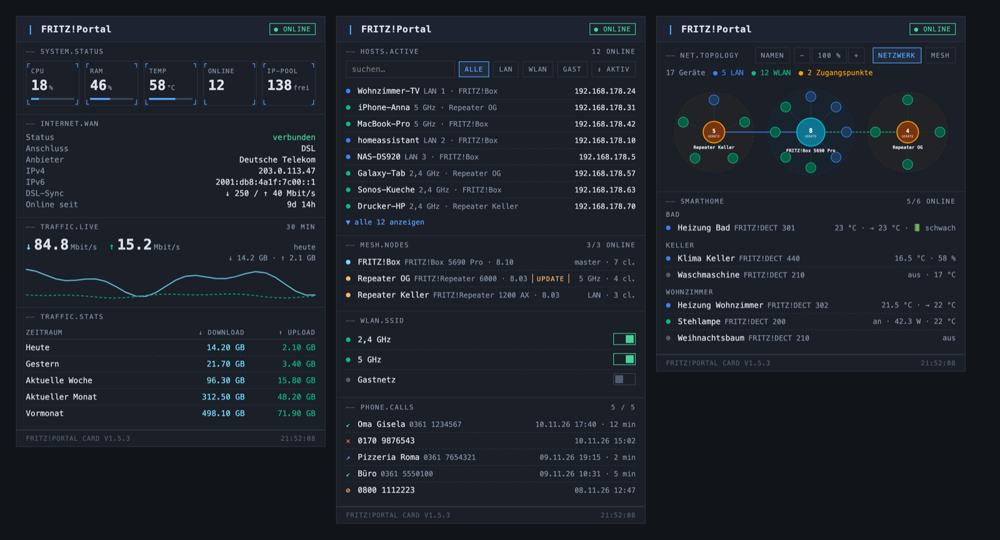
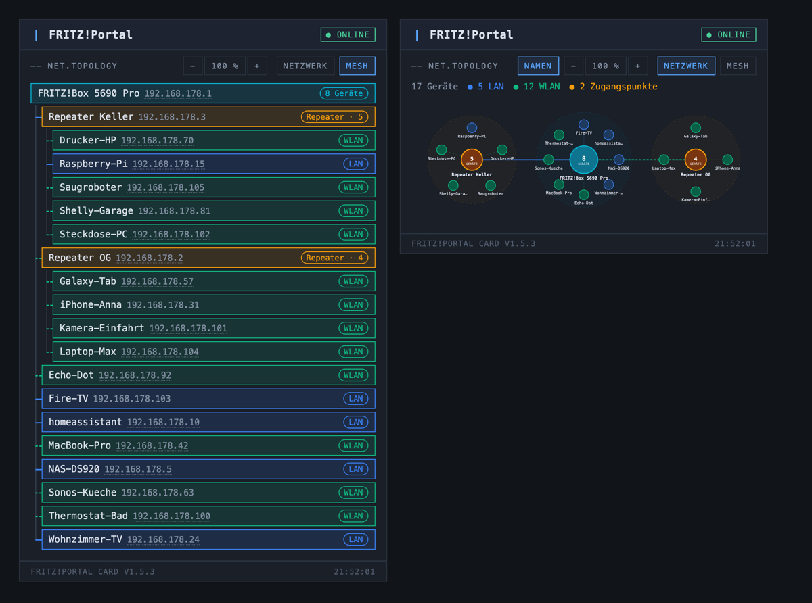

# FRITZ!Portal — Home Assistant Add-on

Dashboard für Ihre FRITZ!Box, direkt in Home Assistant integriert.


## Funktionen

- **Dashboard**: Übersicht über FRITZ!Box-Status, CPU, RAM, Temperatur, aktueller Traffic
- **Geräte**: Alle verbundenen Geräte anzeigen und verwalten, inkl. freie IP-Adressen
- **Netzwerk**: LAN, WAN, WLAN-Einstellungen einsehen und ändern
- **Traffic**: Datenverbrauch (Tag, Woche, Monat, Vormonat) und Online-Monitor (Auslastung nach Heimnetz/IPTV/Gastnetz und Priorisierungsklassen)
- **Telefonie**: Anrufliste und DECT-Telefonie; optional Telefonie-Sensoren für HA (letzter Anruf, eingehend/verpasst/ausgehend, je mit Name, Nummer und Zeit als eigene Sensoren)
- **System**: FRITZ!Box-Informationen, Neustart, FRITZ!Portal Version

## Installation

1. Dieses Repository als Custom Repository in Home Assistant einbinden:
   - Einstellungen → Add-ons → Add-on Store → ⋮ → Benutzerdefinierte Repositories
   - URL: `https://github.com/jayjojayson/FRITZ-Portal`
2. **FRITZ!Portal** im Store finden und installieren
3. Konfiguration ausfüllen (siehe unten)
4. Add-on starten und über die Seitenleiste öffnen

## Konfiguration

| Option | Typ | Beschreibung | Beispiel |
|--------|-----|-------------|----------|
| `fritzbox_host` | string | Hostname oder IP der FRITZ!Box | `fritz.box` oder `192.168.178.1` |
| `fritzbox_user` | string | Benutzername für die FRITZ!Box | `Admin` |
| `fritzbox_password` | string | Passwort des Benutzers | `Geheim` |

### FRITZ!Box Benutzer einrichten

1. FRITZ!Box-Oberfläche öffnen (`http://fritz.box`)
2. **System → FRITZ!Box-Benutzer** → Neuen Benutzer anlegen
3. Berechtigungen: **Zugriff auf NAS-Inhalte**, **Sprachnachrichten**, **Smart Home**, **FRITZ!App-Anmeldung**
4. Benutzername und Passwort im Add-on eintragen

## So werden die Daten abgerufen

- FRITZ!Portal nutzt zuerst die **offizielle Schnittstelle TR-064**. Die **Weboberfläche** der Box ergänzt nur, was TR-064 nicht liefert (z. B. CPU/RAM/Temperatur, Traffic-Zähler, feste IP-Adressen) – gedrosselt auf höchstens 2 gleichzeitige Abfragen.
- Daten werden kurz zwischengespeichert (15–60 s); das Panel zeigt beim Öffnen sofort die zuletzt geladene Ansicht und aktualisiert im Hintergrund.
- HA-Sensoren: System alle 60 s, Traffic alle 300 s; Mesh und Firmware erstmals ca. 45 s nach dem Start. Die Netzwerk-Grafik der Card übernimmt Korrekturen aus „Verbindung & Zuordnung" sofort, sonst jede Minute bei Änderungen.
- **Feste IP-Adressen erscheinen nach und nach:** Aktuelle FRITZ!OS-Versionen melden sie nur pro Gerät. FRITZ!Portal fragt das im Hintergrund ab (ab ca. 60 s nach dem Start, nur wenn sonst nichts ansteht), speichert das Ergebnis dauerhaft und frischt es alle 12 h auf. Die Gerätedetails fragen immer frisch ab; Zuweisen/Entfernen im Panel wirkt sofort.
- Mit **„Sitzung dauerhaft aktiv halten"** laufen Sensoren und Hintergrund-Abgleich auch ohne geöffnetes Panel.

Ausführlich: [README – So holt FRITZ!Portal die Daten](https://github.com/jayjojayson/FRITZ-Portal#-so-holt-fritzportal-die-daten-von-der-fritzbox)

## Dashboard-Card

Das Add-on bringt die Karte **`custom:fritz-portal-card`** für eigene HA-Dashboards mit und installiert sie beim Start automatisch (Option `dashboard_card`). Im Dashboard **„Karte hinzufügen" → „FRITZ!Portal"** wählen – alle Einstellungen gibt es auch im visuellen Editor.



Bereiche (frei kombinierbar über `sections`): `system` (CPU, RAM, Temperatur, Geräte, freie IPs), `wan` (Internet, IPs, DSL-Sync), `traffic` (Live-Raten mit 30-min-Verlauf), `traffic_stats` (Heute … Vormonat), `hosts` (aktive Geräte mit Suche/Filter), `mesh` (FRITZ!Box und Repeater), `topology` (Netzwerk-Grafik als Cluster oder Mesh-Baum), `wlan` (WLAN-Schalter), `phone` (letzte Anrufe), `smarthome` (DECT-Geräte nach Raum oder Typ).

```yaml
type: custom:fritz-portal-card
title: FRITZ!Box
sections: [system, traffic, hosts]
theme: auto          # auto | dark | light
ha_style: false      # true = Design des aktiven HA-Themes
```




Alle Optionen und weitere Beispiele: [README – Dashboard-Card](https://github.com/jayjojayson/FRITZ-Portal#fritzportal-dashboard-card-ab-v147)

## Einzelne Geräte in Home Assistant

In den Gerätedetails lässt sich jedes Gerät per Schalter **„In Home Assistant bereitstellen"** als eigenes HA-Gerät anlegen (MQTT): Schalter Internetzugang, Button Aufwecken (WoL), Online-Status, IP und Verbindung – z. B. für Automationen. Ausschalten entfernt es wieder. Für Befehle aus HA „Sitzung dauerhaft aktiv halten" einschalten.

## Sicherheit

FRITZ!Portal ist nur über die Seitenleiste von Home Assistant erreichbar (Ingress, Anmeldung als HA-Administrator). Direkte Aufrufe aus dem Heimnetz, z. B. `http://<HA-IP>:3003`, sind seit v1.5.2 bewusst nicht mehr möglich: Dieser Weg lief ohne Anmeldung und hätte jedem Gerät im Netz die Steuerung der FRITZ!Box erlaubt (GHSA-h565-vx6r-3rhv).

## Support

Bei Problemen: https://github.com/jayjojayson/FRITZ-Portal/issues
