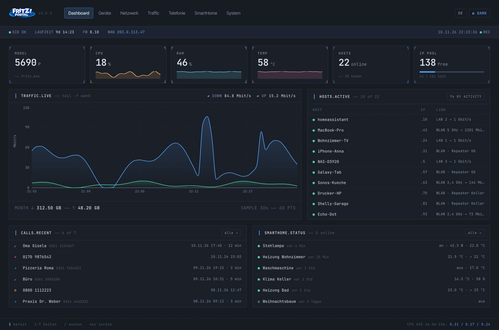
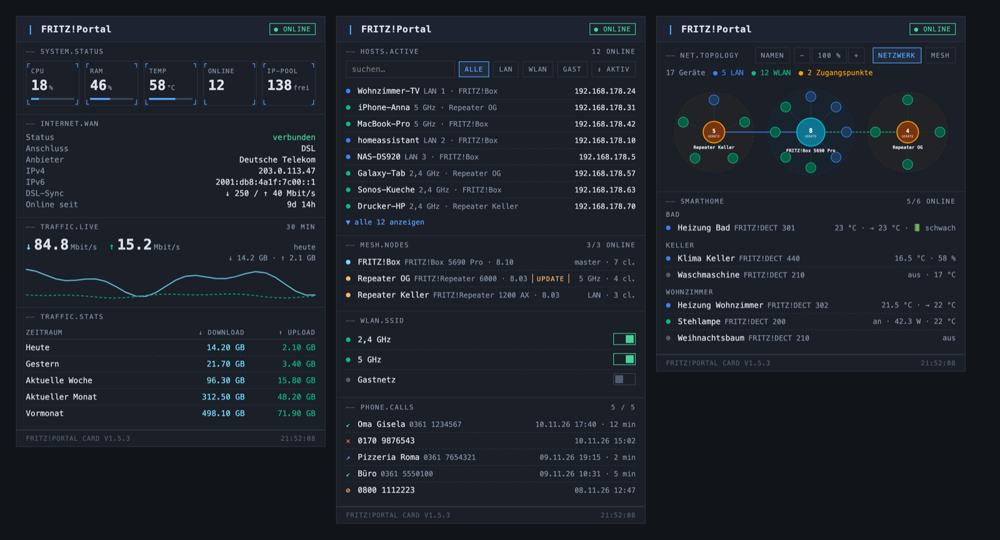

# FRITZ!Portal

**Das moderne FRITZ!Box-Dashboard für Home Assistant.** FRITZ!Portal zeigt dir alles Wichtige deiner FRITZ!Box auf einen Blick – Auslastung, Traffic, Geräte, Mesh, Anrufe und Smart Home – und bringt die Werte als Sensoren, Schalter und Events nach Home Assistant. Gerätenamen ändern, feste IP-Adressen vergeben oder einem Gerät das Internet sperren geht direkt aus der Oberfläche, ohne die FRITZ!Box-Seite zu öffnen. Dank Ingress läuft alles in der Seitenleiste von Home Assistant, ohne Portfreigabe.

*🇬🇧 A modern FRITZ!Box dashboard for Home Assistant – live status, devices, mesh, traffic, calls and smart home, plus sensors, switches and events for your automations. German, English and Italian.*

## Was FRITZ!Portal kann

- 📊 **Dashboard** – CPU, RAM, Temperatur, Geräte und IP-Pool mit Verlauf, Live-Traffic, aktive Geräte, letzte Anrufe und Smart-Home-Status
- 💻 **Geräte** – alle Geräte mit Suche und Filter; umbenennen, IPv4 fest zuweisen, Zugangsprofil wählen, Internet sperren
- 🕸️ **Netzwerk** – Mesh-Topologie als Baum oder Netzwerk-Grafik, WLAN je Funknetz ein/aus (z. B. Gastzugang), LAN, WAN und DHCP
- 📈 **Traffic** – Online-Zähler (Heute bis Vormonat) und Online-Monitor wie in der FRITZ!Box
- ☎️ **Telefonie & 🏠 SmartHome** – Anrufliste, DECT-Telefone und alle Smart-Home-Geräte inkl. Zigbee
- 🧩 **Dashboard-Card** – eigene Lovelace-Karte im Portal-Look oder im HA-Design, wird automatisch installiert
- 🔌 **Home-Assistant-Integration** – Sensoren per MQTT, WLAN-Schalter, Internetzugang und Wake-on-LAN je Gerät, Telefonie-Sensoren, Events bei neuen Geräten oder neuer externer IP
- 🎨 **Zwei Designs** – Terminal-Look oder Home-Assistant-Design, jeweils hell und dunkel; Deutsch, Englisch, Italienisch

## Eindrücke

## In drei Schritten loslegen

1. Unter **Konfiguration** Adresse, Benutzer und Passwort der FRITZ!Box eintragen.
2. App **starten**.
3. Über die **Seitenleiste** oder „Benutzeroberfläche öffnen" aufrufen.

Welche Rechte der FRITZ!Box-Benutzer braucht, was die Optionen bedeuten und wie du die Card und die Sensoren nutzt, steht im Reiter **Dokumentation**.

---

Gefällt dir FRITZ!Portal? Dann freue ich mich über einen ⭐ auf [GitHub](https://github.com/jayjojayson/FRITZ-Portal). Fragen, Ideen und Fehler gern als [Issue](https://github.com/jayjojayson/FRITZ-Portal/issues).
